  

  <code>Ciência de Dados</code> ·
  <code>Desenvolvimento de Software</code> ·
  <code>Gestão e Operações</code>

## Sobre mim

Atualmente, sou **COO (Diretor de Operações) na Winup Network**, com formação em Análise e Desenvolvimento de Sistemas e pós-graduando em Ciência de Dados e Machine Learning.

Meus interesses estão na interseção entre estatística, tecnologia e estratégia de negócios.

Busco compreender padrões, desenvolver soluções tecnológicas e otimizar operações por meio da análise de dados.

> Transformando dados em informação, informação em conhecimento e conhecimento em decisões.

## Áreas de atuação

| Ciência e Análise de Dados | Desenvolvimento | Gestão e Operações |
| :--- | :--- | :--- |
| Análise exploratória de dados | Desenvolvimento Full-Stack | Gestão de operações |
| Análise estatística | Integração de APIs REST | Gestão de equipes |
| Visualização de dados | Desenvolvimento Backend | Otimização de processos |
| Business Intelligence | Integração de bancos de dados | Análise de desempenho |
| Análise preditiva | Automação de processos | Decisões orientadas por dados |

## Tecnologias e ferramentas

### Ciência e Análise de Dados

  
  &nbsp;
  
  &nbsp;
  
  &nbsp;
  
  &nbsp;
  
  &nbsp;
  

`Python` · `Pandas` · `NumPy` · `SQL` · `Jupyter` · `Power BI` · `Matplotlib` · `Scikit-learn`

### Desenvolvimento de Software

  
  &nbsp;
  
  &nbsp;
  
  &nbsp;
  
  &nbsp;
  

`JavaScript` · `TypeScript` · `Next.js` · `Django` · `PHP` · `APIs REST`

### Banco de Dados e Infraestrutura

  
  &nbsp;
  
  &nbsp;
  
  &nbsp;
  
  &nbsp;
  

`PostgreSQL` · `MySQL` · `Docker` · `Git` · `Linux`

## Fluxo de análise de dados

  

## Estatísticas do GitHub

  

## Estudos e pesquisas

Atualmente, estou aprofundando meus conhecimentos em:

- Estatística aplicada e probabilidade
- Álgebra linear
- Ciência de dados
- Machine Learning
- Modelagem preditiva
- Inteligência artificial
- Business Intelligence
- Automação inteligente
- Computação em nuvem

## Idiomas

| Idioma | Proficiência |
| :--- | :--- |
| 🇧🇷 Português | Nativo |
| 🇺🇸 Inglês | Fluente |
| 🇪🇸 Espanhol | Em aprendizado 

## Além da tecnologia

Interesses que vão além da minha atuação profissional.

⚛️ Física · ♟️ Xadrez · 🥊 Boxe · 🔴⚫ Flamengo

## Conecte-se comigo

---

 

DADOS · CIÊNCIA · TECNOLOGIA · LIDERANÇA

